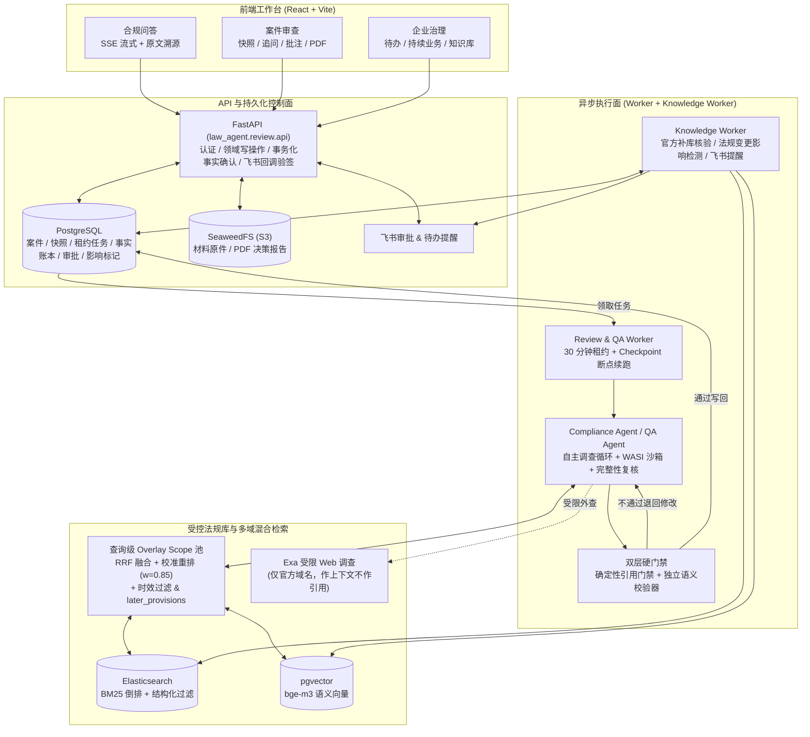

<div align="center">

# CrossComply

**面向企业数据出境合规的有状态调查 Agent 与全流程审查工作台**

*Stateful Compliance Agent · Controlled Legal RAG · Verifiable Citation Gate · Enterprise Governance*

[](https://github.com/raydemo1/crosscomply-agent/actions/workflows/ci.yml)


[为什么做 CrossComply](#为什么做-crosscomply) · [完整能力全景](#完整能力全景) · [系统架构](#系统架构) · [关键技术设计](#关键技术设计) · [实测表现](#实测表现) · [快速开始](#快速开始)

</div>

---

## 为什么做 CrossComply？

企业数据出境合规（安全评估、标准合同备案、个人信息保护认证、自贸区负面清单豁免）是典型的高风险法律决策场景。直接拿通用大模型或普通 RAG 去做合规审查，往往会撞上四道硬墙：

| 痛点 | 通用大模型 / 普通 RAG 的常见表现 | CrossComply 的工程解法 |
| --- | --- | --- |
| **时效与新旧法幻觉** | 2024 年规定已将安全评估有效期从 2 年延至 3 年、2025 年第 53 号公告已将认证依据从 TC260 换为 GB/T 46068，裸模型仍自信输出废止旧规 | 每轮绑定审查时点 `as_of_date`；入库抽取新旧法 `precedence_relations`，读到旧规时自动挂载现行新规条款供 Agent 精读 |
| **条号错引与伪造依据** | 36 题跨模型盲测中同底座裸模型 **72.2%** 存在法条/条号错误，或把政策问答/指南当成法定条款引用 | **引用资格三层模型** + **确定性引用门禁**：所有条款引用必须来自本次已取得的有效法条原文，辅助材料禁止冒充法条 |
| **事实不清时强行下结论** | 遇到部门材料矛盾、缺少 CIIO 或重要数据确认时直接拍脑袋给“免予申报”等危险结论 | **可暂停恢复的有状态 Agent** + **事实来源账本**：信息不足时持久化暂停追问申请人，不编造、不越权改写事实 |
| **缺少企业级治理闭环** | 只能聊几句天，无法处理同主体跨业务累计人数、法规更新后的历史审批复审、法务审批与整改留痕 | 内置不可变快照、同主体累计台账、法规变更影响自动标红、飞书验签审批、SHA-256 PDF 决策报告与整改追踪 |

---

## 完整能力全景

CrossComply 采用**“合规即时问答 + 正式案件审查 + 持续业务与知识治理”**三位一体设计，清晰划定 **Agent（调查与起草） / 程序（冻结、门禁与持久化） / 人（事实确认、审批与治理）** 三方边界：

### 1. 合规问答工作台（Compliance Q&A）
- 无需建案即可发起专业合规咨询，支持上传多份业务说明与多工作表 Excel 数据清单；
- Agent 自主规划查询、按条精读法规、必要时向用户追问，经 **SSE 流式推送**实时展示调查轨迹与回答；
- 答后自动执行**完整性复核（缺口检测 → 继承检索域补查 → 修订定稿）**，每个 `[依据N]` 均可点击溯源法条原文；
- 复杂咨询可**一键转为正式审查案件**，对话与材料无缝继承。

### 2. 有状态案件审查与双层门禁（Case Review）
- **不可变快照冻结**：立案提交审查时，冻结材料版本快照（`MaterialSnapshot`）、申报事实快照（`IntakeSnapshot`）与同主体自然年累计台账（`PortfolioSnapshot`）；
- **10 类受控调查工具**：分页读取材料与 Excel 工作表、`grep_materials` 精确搜索、**WASI Python 沙箱**做数据统计核算、受控多域混合检索、按条精读、受限官方 Web 调查、提交在线补库、持久化暂停追问申请人、提交结构化报告草稿；
- **硬性双层门禁**：报告草稿必须依次通过**确定性引用门禁**（法律效力 + 条款定位 + 材料原文精确命中 + 时效校验）与**独立语义校验器**（`SemanticGroundingVerifier` 逐条核验主张、路径、地域/行业边界与事实充分性），不通过则带诊断反馈退回 Agent 修订；
- **案件内问答与批注**：绑定当前快照与已审报告，支持法务原文批注、修改建议与受控案件问答；新事实仅作为待确认建议，经申请人事务化确认后触发重审。

### 3. 企业治理、审批与法规变更监测
- **飞书验签审批闭环**：审查人复核后发起飞书审批，审批终态**仅由验签且幂等的飞书回调事件写回**（Agent 绝无对外审批或发消息权限）；
- **带校验和的决策交付**：自动生成含 SHA-256 摘要的 PDF 合规决策报告与整改动作清单，支持整改证据提交与验收；
- **持续出境业务与同主体累计**：按主体与自然年聚合持续业务的已批基线，自动预警跨档风险（如累计人数逼近 10 万 / 100 万门槛）；
- **法规变更影响自动标红**：知识库发布新规或版本变更时，自动比对历史审批基线与待审报告的引用条款，阻断级变更拦截送审并提醒法务复审；
- **在线知识库治理与纠错回流**：Agent 发现的新官方来源可提交补库核验队列，经人工审定后入库；线上人工纠错经法务脱敏后可回流为 `field` 评测场景。

---

## 系统架构



---

## 关键技术设计

### 1. 受控数据治理与引用资格三层模型
- **六阶段可审计离线流水线**：`Source Manifest → Fetch → 多格式解析（JSON / DOCX 纵向合并单元格还原 / HTML 响应式去重 / PDF 跨页表与 Docling OCR）→ 确定性清洗 → LLM 语义增强 → 结构感知分块`。
- **按文档类型精细分块**：法律法规按“条/款”切分并保留编章节路径；自贸区负面清单表格按“分节路径 + 列名 + 单行”拼装，确保任意一行独立召回后仍完整保留行业与触发程序上下文；官方问答按“一问一答”切块。
- **引用资格三层解耦**：将**法律效力**（正式法规 vs 指南/问答/标准）、**条款定位**（是否存在明确条号）与**案件适用性**（地域/行业/时点）解耦，从入库阶段即决定 `can_cite_clause`，杜绝把辅助解读包装为法条。
- **模型优先、规则兜底的在线入库**：正文 ≤ 16,000 字直读全文（`FULL_TEXT_THRESHOLD = 16_000`），网页正文通过模型抽取原文逐字起止锚点精确去噪（绝不改写条文），同步抽取新旧法 `precedence_relations` 并以规则兜底。

### 2. 查询级多域混合检索与校准重排
- **动态 Overlay 检索池**：根据当前语料动态生成合法 `scope` 枚举注入工具 Schema（`全国通用`、`地区:上海/北京/天津/深圳/粤港澳大湾区(香港/澳门)`、`行业:汽车/工信`、`全库`）。选定专门域时在全国上位法之上叠加该专门域，同时排除无关地方/行业干扰；全国通用池对非条款类文件设 `NATIONAL_NON_CLAUSE_SLOTS = 3` 上限，保障正式法条席位。
- **跨查询可比校准重排**：ES BM25 与 pgvector（`bge-m3`）各取 Top-50 经 RRF 融合，送入 `bge-reranker-v2-m3` 并附带文件类型、章节路径与适用地域元数据，按 `0.85 × rerank + 0.15 × fused` 保留跨查询可比打分（摒弃易失真的单查询 min-max 拉伸）。
- **正文 + Top-8 预览 + 新规线索**：单批最多返回 10 段正文（≤ 250 字短条文直接全量返回不占名额），其余 Top-8 以查询相关句预览呈现，并在旧规来源上自动挂载现行 `later_provisions` 引导按条精读。

### 3. 状态机、租约持久化与防泄漏评测
- **可恢复长任务**：审查任务经 `queued → running → waiting_input → succeeded / failed / superseded` 流转，30 分钟租约配合每次 Checkpoint 自动续约，进程重启可从最近检查点续跑；申请人确认事实采用单事务原子落库，失败整体回滚。
- **独立三层防泄漏评测**：构建 78 个企业出境合规场景（`dev` 42 题调优、`test` 36 题散列锁定），分离离线查询回放（消融调参）、多轮条款级证据召回（支持等价条款组与 `no-leak` 去直接答案子集）和跨模型双盲最终回答评测。

---

## 实测表现

以下全部数据均在**锁定测试集 `test`（36 题，从未用于调参，36/36 完成）**与 **65 份官方受控语料（2,119 分块、46.9 万字）**上测得：

### 1. 多轮自主问答证据召回（锁定 `test` 36 题）

| 评测范围 | 必引条款证据召回 | 必引条款回答引用 | 必检来源召回 | 确定性引用门禁 |
| --- | ---: | ---: | ---: | ---: |
| **全部场景（36 题，74 条必引条款）** | **90.5%** | **85.1%** | **90.0%** | **97.2% (35/36)** |
| **不含直接答案子集（31 题，63 条）** | **88.9%** | **84.1%** | **92.3%** | **96.8% (30/31)** |

### 2. 端到端回答质量跨模型双盲对照（72 条匿名盲评）
> 同一底座模型（DeepSeek）分别以 CrossComply 问答 Agent 与裸模型 `direct` 作答，72 条交付匿名打乱并剥离系统标识，由独立第三方模型 **`claude-opus-5.5`** 按 `agent_rubric` 逐条盲评：

| 评测指标（锁定 `test` 36 题） | CrossComply 问答 Agent | 同底座裸模型 (`direct`) | 差值 |
| --- | ---: | ---: | ---: |
| **总体通过率（`overall_pass`）** | **97.2% (35/36)** | 86.1% (31/36) | **+11.1 pp** |
| **不含直接答案子集通过率（31 题）** | **96.8% (30/31)** | 87.1% (27/31) | **+9.7 pp** |
| **法律准确性完全无瑕（`legal_correctness = pass`）** | **77.8% (28/36)** | 13.9% (5/36) | **+63.9 pp** |
| **法条/条号小错率（`minor_issue`）** | **19.4% (7/36)** | 72.2% (26/36) | **-52.8 pp** |
| **危险错误率（`wrong_definite`）** | **0.0% (0/36)** | 2.8% (1/36) | **-2.8 pp** |

### 3. 工程延迟与单次问答成本（官方默认 `deepseek-flash`）

| 维度 | 实测指标 |
| --- | --- |
| **生产混合检索（ES + pgvector + 重排）** | 单查询 **P50 1.37 s / P95 1.51 s**；批量查询（2.3 条/批）**P50 2.44 s / P95 3.40 s** |
| **端到端多轮问答（含完整性复核）** | 中位数 **1 次检索 / 4 次精读**，端到端 **P50 54.1 s / P95 76.0 s** |
| **单次深度合规问答估算成本** | 无缓存上限均值 **¥0.29**（叠加官方 Prefix Cache 后实际约 **¥0.10–0.18 / 次**） |

---

## 快速开始

### 环境要求
- **Python 3.11+**、**Node.js 22.12+**、**Docker & Docker Compose**
- OpenAI 兼容大模型 API、Embedding 服务（默认 `bge-m3`）与 Rerank 服务（默认 `bge-reranker-v2-m3`）

### 一键容器启动

```bash
# 1. 安装 Python 依赖（如需本地运行 CLI 或测试）
pip install -e ".[dev,service]"

# 2. 复制环境变量模板并填入数据库、SeaweedFS、大模型与检索服务配置
cp .env.example .env

# 3. 启动全部基础设施与应用容器（PostgreSQL/pgvector、Elasticsearch、SeaweedFS、API、Worker、Knowledge-Worker、Frontend）
docker compose up -d --build

# 4. 执行数据库迁移并初始化管理员账号
python -m alembic upgrade head
python -m law_agent.review.bootstrap_admin
```

### 本地开发与测试

```bash
# 后端 API / Worker / Knowledge-Worker（三进程独立启动）
uvicorn law_agent.review.api:app --reload
python -m law_agent.review.worker
python -m law_agent.kb.enrichment_worker

# 前端开发服务器
cd frontend && npm install && npm run dev

# 全量自动化测试（后端 1,149+ 单测 + 前端测试与构建）
pytest
cd frontend && npm test && npm run build
```

---

## 仓库结构

<details>
<summary>点击展开核心模块地图</summary>

| 目录 | 核心职责 |
| --- | --- |
| `law_agent/review/` | 案件审查与合规问答核心：`agent.py`（决策循环与预算）、`agent_runtime.py`（任务组装）、`agent_tools.py`（受控工具与引用门禁）、`semantic_grounding.py`（独立语义校验）、`qa_agent.py`（合规问答与完整性复核）、`matter_agent.py`（案件问答）、`portfolio.py`（同主体累计）、`impact.py`（法规变更影响）、`feishu.py`（审批回调验签）、`reports.py`（PDF 决策报告）、`worker.py`（租约任务执行）、`http/`（FastAPI 业务路由） |
| `law_agent/review/retrieval/` | 混合检索引擎：`scopes.py`（Overlay 检索域）、`hybrid.py`（ES + pgvector）、`fusion.py`（RRF）、`boosts.py`（软加权）、`rerank.py`（校准重排）、`selection.py`（Rank-Aware 选文）、`temporal.py`（时效过滤）、`later_provisions.py`（新旧法关联） |
| `law_agent/data/` | 离线数据治理六阶段流水线、多格式文档解析（DOCX/PDF/HTML/Docling OCR）、结构感知分块与引用资格三层模型（`citation_policy.py`、`source_rules.py`） |
| `law_agent/kb/` | 在线知识库管理、模型优先网页去噪与新旧法关系抽取（`source_llm.py`）、法规变更检测（`change_detection.py`）与补库核验 Worker（`enrichment_worker.py`） |
| `law_agent/llm/` | OpenAI 兼容统一流式客户端、`json_repair` 兜底、重试预算与 Token/TTFT 用量统计（`usage.py`） |
| `law_agent/evals/` | 独立评测框架：78 题场景库与散列锁定、离线查询回放、多轮证据召回计分、跨系统盲评与 Wilson 区间报告 |
| `frontend/` | React + Vite 企业审查与合规问答工作台 |
| `alembic/` & `docker/` & `scripts/` | 数据库迁移、容器编排、Nginx/中文字体与语料迁移脚本 |
| `tests/` | 1,149+ 自动化单元测试与集成测试 |

> `data/`（语料、模型缓存、评测产物）、`output/`、`tmp/` 与 `model-profiles/` 均不进 Git。

</details>

---

## 许可

[MIT](LICENSE)
