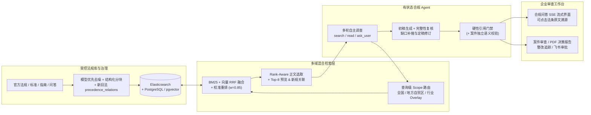

<div align="center">

# CrossComply

**面向企业数据出境合规的自主调查 Agent 与审查工作台**

*Controlled Legal Retrieval · Temporal Precedence · Multi-Round Investigation · Verifiable Citations*

[](https://github.com/raydemo1/crosscomply-agent/actions/workflows/ci.yml)


[架构概览](#系统架构) · [评测表现](#评测表现) · [快速开始](#快速开始) · [完整技术深潜](docs/retrieval-qa-and-eval-deep-dive.md) · [评测报告](EVALUATION_REPORT.md)

</div>

---

## 为什么做 CrossComply？

通用大模型回答法律合规问题时，最危险的不是“完全不知道”，而是**自信地引用已废止旧规、编造条号，或在事实矛盾时强行下结论**：

- 2024 年《促进和规范数据跨境流动规定》已将数据出境安全评估有效期从 **2 年延长至 3 年且可申请延长**，裸模型仍常按 2022 旧规给出确定性错误结论；
- 2025 年第 53 号公告已将个人信息跨境认证技术依据从旧版 **TC260 实践指南** 替换为 **GB/T 46068**，通用模型仍频繁沿用旧标准；
- 在 36 道真实企业出境合规场景盲测中，同底座裸模型有 **72.2%** 的回答存在法条/条号错误或遗漏。

**CrossComply** 通过「受控法规库 + 查询级多域混合检索 + 新旧法衔接关联 + 多轮自主精读与完整性复核 + 硬性引用门禁」，把合规问答与案件审查做成**可追溯、可暂停追问、证据不足不瞎猜**的工程闭环。

---

## 核心特性

| 能力 | 设计亮点 |
| --- | --- |
| **多域混合检索与校准重排** | 覆盖 65 份官方法规/标准/指南（2,119 分块、46.9 万字），按全国通用 / 地方自贸区（沪京津深、粤港澳大湾区）/ 行业（汽车、工信等）构建查询级 overlay 检索池；ES BM25 + pgvector 融合并经 Cross-Encoder 校准重排（单查询 P50 1.37s） |
| **时效与新旧法衔接** | 每轮绑定审查时点 `as_of_date`，自动过滤未生效/已废止条文；入库阶段“模型优先、规则兜底”抽取网页正文与 `precedence_relations`，让 Agent 读到旧规时顺藤摸瓜精读现行新规 |
| **多轮自主调查与完整性复核** | Agent 自主规划查询、按条精读、必要时暂停向申请人追问并在补充事实后恢复；作答后执行完整性复核（识别覆盖缺口 → 继承检索域补搜 → 修订定稿），全链路 SSE 流式返回 |
| **硬性引用门禁与语义校验** | 回答与报告中的每个条款引用必须来自本次已取得的有效证据原文，问答/指南类辅助来源禁止冒充法定条款引用；案件审查额外经过独立语义核验 |
| **企业工作台与审批闭环** | 支持独立合规问答（可一键转正式案件）、多文件/Excel 材料解析、原文批注、PDF 决策报告、整改跟踪、飞书验签审批与在线知识库治理 |
| **防泄漏评测体系** | 内置 `dev`（42 题）/ 锁定 `test`（36 题）场景库，支持离线检索回放、条款级多轮召回与跨模型双盲评测 |

---

## 系统架构



> 想深入了解检索公式、多轮状态机、完整性复核与三层评测的代码级实现？请阅读 **[检索、问答与评测完整技术深潜](docs/retrieval-qa-and-eval-deep-dive.md)**。

---

## 评测表现

以下结果全部来自**从未用于调参的锁定测试集 `test`（36 题，36/36 完成）**，完整记录见 [EVALUATION_REPORT.md](EVALUATION_REPORT.md)：

### 1. 多轮自主问答证据召回（锁定 `test` 36 题）

| 范围 | 必引条款证据召回 | 必引条款回答引用 | 必检来源召回 | 确定性引用门禁 |
| --- | ---: | ---: | ---: | ---: |
| **全部场景（36 题）** | **90.5%** | **85.1%** | **90.0%** | **97.2% (35/36)** |
| **不含直接答案子集（31 题）** | **88.9%** | **84.1%** | **92.3%** | **96.8% (30/31)** |

### 2. 端到端回答质量跨模型双盲对照（同底座 DeepSeek，裁判：`claude-opus-5.5`）

| 指标（36 题 × 2 系统 = 72 条匿名打乱盲评） | CrossComply 问答 Agent | 同底座裸模型 (`direct`) | 提升 |
| --- | ---: | ---: | ---: |
| **总体通过率（`overall_pass`）** | **97.2% (35/36)** | 86.1% (31/36) | **+11.1 pp** |
| **法律准确性完全无瑕（`legal_correctness = pass`）** | **77.8% (28/36)** | 13.9% (5/36) | **+63.9 pp** |
| **法条/条号小错率（`minor_issue`）** | **19.4% (7/36)** | 72.2% (26/36) | **-52.8 pp** |
| **危险错误率（`wrong_definite`）** | **0.0% (0/36)** | 2.8% (1/36) | **-2.8 pp** |

### 3. 工程延迟与成本画像（官方默认 `deepseek-flash`）
- **生产混合检索（ES + pgvector + 重排）**：单查询 **P50 1.37s / P95 1.51s**；批量查询（2.3 条/批）**P50 2.44s / P95 3.40s**。
- **端到端多轮问答**：中位数 **1 次检索 / 4 次精读**，端到端 **P50 54.1s**，单次深度合规问答成本约 **¥0.10–0.29**。

---

## 快速开始

需要 **Python 3.11+**、**Node.js 22.12+**、**Docker**。

```bash
# 1. 安装后端依赖
pip install -e ".[dev,service]"

# 2. 配置环境变量（数据库、对象存储密码与模型密钥，见 docs/configuration.md）
cp .env.example .env

# 3. 启动全套服务（PostgreSQL/pgvector、Elasticsearch、MinIO、API、Worker、Frontend）
docker compose up -d --build
```

首次部署需创建管理员并建立检索索引，详见 [部署指南](docs/deployment.md)；宿主机本地开发（API + Worker + Vite 热重载）见 [开发指南](docs/development.md)。

### 运行测试

```bash
pytest
cd frontend && npm test && npm run build
```

CI（`.github/workflows/ci.yml`）在每次推送与 PR 上运行相同检查（后端 1,149+ 单测 + 前端测试与构建）。

---

## 文档导航

| 文档 | 适合阅读的场景 |
| --- | --- |
| **[检索、问答与评测完整技术深潜](docs/retrieval-qa-and-eval-deep-dive.md)** | 全面理解语料入库、多域混合检索、多轮问答状态机、完整性复核与三层评测的代码级实现 |
| **[评测全记录报告](EVALUATION_REPORT.md)** | 查看锁定 `test` 集全量指标、离线检索消融与证伪记录、性能延迟与成本数据 |
| **[系统架构](docs/architecture.md)** | 了解案件审查状态机、Agent 动作与预算、程序保证与人工审批边界 |
| **[数据治理](docs/data-governance.md)** | 了解法律知识如何进入受控证据库、引用资格规则、分块与解析器 |
| **[评测手册](docs/evaluation.md)** | 场景库规范、审定锁定流程与各评测子命令用法 |
| **[开发指南](docs/development.md)** / **[部署指南](docs/deployment.md)** / **[配置参考](docs/configuration.md)** | 本地调试、语料迁移、生产部署与环境变量说明 |

---

## 仓库结构

<details>
<summary>点击展开目录说明</summary>

| 路径 | 用途 |
| --- | --- |
| `law_agent/review/` | 生产 Agent runtime、问答与案件 Worker、FastAPI 路由（`http/`）、混合检索与重排（`retrieval/`） |
| `law_agent/kb/` | 在线知识库入库、模型优先网页去噪与新旧法关系抽取、补库核验 Worker |
| `law_agent/data/` | 离线数据治理流水线、引用资格策略（`citation_policy.py`）与数据结构定义 |
| `law_agent/llm/` | OpenAI 兼容流式客户端、Embedding、重试预算与 Token 用量统计 |
| `law_agent/evals/` | 独立评测系统：场景库、离线查询回放、多轮问答计分、跨系统盲评与报告 |
| `frontend/` | React + Vite 企业审查工作台（含公开演示站虚构数据 `src/demo/`） |
| `alembic/` | PostgreSQL 数据库迁移脚本 |
| `docker/` | 容器镜像、Nginx 配置与 PDF 报告字体 |
| `scripts/` | 语料打包/恢复、本地 `.env` 初始化与法规变更离线演示脚本 |
| `tests/` | pytest 测试套件 |

> `data/`（语料、模型缓存、评测产物）、`output/`、`tmp/` 与 `model-profiles/` 均不进 Git。

</details>

---

## 许可

[MIT](LICENSE)
