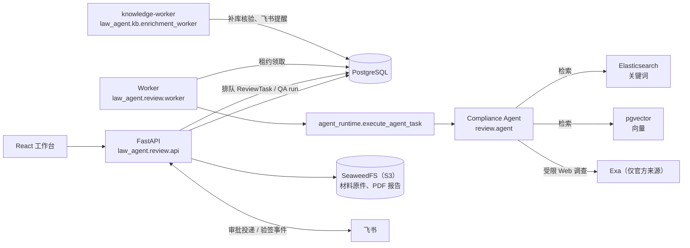

# 架构

CrossComply 用**一个** Compliance Agent 完成案件调查和报告起草。职责划分如下：

- **Agent** 决定读什么、查什么、何时追问、何时交付；
- **程序** 负责冻结输入、执行工具、限制预算、校验引用、持久化状态，并执行所有对外动作；
- **人** 确认事实、复核报告、发起和完成审批、验收整改、治理知识库。

本文只描述当前实现。

## 运行组件



| 进程 | 入口 | 职责 |
| --- | --- | --- |
| API | `law_agent.review.api:app` | HTTP 接口、认证、领域写操作；只排队任务，不直接跑 Agent |
| Worker | `python -m law_agent.review.worker` | 依次领取审查任务和问答任务，调用 runtime，回写结果 |
| knowledge-worker | `python -m law_agent.kb.enrichment_worker` | 处理 Agent 提交的补库来源，发送飞书待办提醒 |

检索必须同时连通 ES 与 pgvector，任一不可用即显式失败，没有本地回退；LLM 节点也没有规则兜底。

## 审查流程

1. 申请人创建案件、上传材料、确认申报事实。
2. 发起审查时，程序冻结 `MaterialSnapshot`（材料版本与解析文本）和 `IntakeSnapshot`（确认事实），排队一个 `ReviewTask`。
3. Worker 领取任务，Agent 循环决策，直到交付、暂停追问或预算耗尽。
4. 交付的报告依次经过确定性引用门禁和独立语义校验；不通过则带着反馈退回 Agent 修改。
5. Worker 写回结果和整改动作清单，并按结果推进案件状态。
6. 审查人复核后发起飞书审批；验签后的审批事件写回终态，需要时生成带 SHA-256 的 PDF 决策报告。

## Agent 的动作

每一轮模型输出一个 `AgentDecision`（`law_agent/review/agent.py`）JSON，由程序执行其中的单个动作。没有固定步骤顺序。

| 动作 | 作用 |
| --- | --- |
| `propose_plan` | 更新对用户可见的计划，不暂停运行 |
| `read_material` / `read_materials` | 分页读取冻结材料；单次最多返回 48,000 UTF-8 字节，XLSX 可按工作表读取 |
| `grep_materials` | 在冻结材料中字面搜索，返回命中位置和上下文 |
| `run_python` | 在 WASI 沙箱中处理材料数据（需配置 `LAWAGENT_WASI_PYTHON_ROOT`） |
| `search_evidence` | 1–4 个查询的受控混合检索，每批最多返回 10 段原文 |
| `read_evidence` | 1–4 个读取请求：按条号、chunk 或来源目录精读已检索到的来源 |
| `search_web` | 在受控库不足或需核实时效时检索官方来源；结果只作调查上下文，不能作为引用证据 |
| `queue_enrichment` | 把新官方来源提交补库，单次运行最多 2 条；入库前没有引用资格 |
| `request_input` | 持久化暂停，向申请人提问，可附结构化 `fact_questions` |
| `finish` | 提交结构化报告草稿，进入门禁 |

默认预算（`AgentState`）：16 轮、5 次检索、10 次读取、5 次 Web 搜索、2 条补库。预算耗尽只能以 `insufficient_evidence` 收口。

### 检索

- **查询级检索域（overlay 池）**：每次检索的每条查询均可指定 `scope`（`retrieval/scopes.py`），合法取值由当前语料动态生成并注入 `search_evidence` 工具 JSON Schema `enum`（默认 `全国通用`）：
  - `全国通用`：仅全国通用法规、指南、问答和国家标准，排除地方自贸区负面清单及特定行业专门规定；
  - `地区:<地区名>` / `行业:<行业名>`：在 `全国通用` 基础上叠加该地区或行业专门文件（保留上位全国通用法源，同时排除其他无关地区/行业）；其中粤港澳大湾区拆分为 `地区:粤港澳大湾区（香港）` 与 `地区:粤港澳大湾区（澳门）`，且 `地区:广东` / `地区:深圳` 同时覆盖大湾区规则，避免按省市检索时误滤大湾区指引；
  - `全库`：跨多个地区或行业横向对比时使用。
- 每个查询内部先按 `scope` 与审查时点过滤候选，再融合关键词和向量结果（各取前 50 候选）。一批查询共享 10 个正文名额：每条查询先按席位重排后的自身排序拿前 2 个位置，剩余名额优先在各查询前 8 名内按校准分分配（被顺延的非条文项不插队抢占正文槽）；同一条或同一标题段只占一个名额，重复命中不额外加分。
- 排序按案件地域、行业和查询用途做软加权（`retrieval/boosts.py`）：未指定显式地域/行业 `scope`（或使用 `全库`）时，依据申请人确认的填报对条件性地方/行业规范加权或降权；已指定显式 `scope`（非 `全库`）时，跳过与查询域冲突的事实级地域/行业升降权，避免误压制显式查询目标。
- 每次检索返回一个结果列表（`results`）：按来源分组、按排名排列，列出每条查询前 8 名的位置，以及已取得正文的位置。每个位置要么 `acquired`（原文已进入证据，带引用标记，可以引用），要么只有 250 字 `preview`（预览不能引用，需要时精读）。不超过 250 字的完整条文或章节直接给全文（acquired），不占正文名额；知识库九成以上的条文在这个长度内。预览从与该条查询字面最接近的句子开始截取，而不是固定截开头；一块如果是某节的续段，前面附上这一节的标题（如问答的问题）。问答类文件按"一问一答"切块，问题即标题。来源附文件类型（`doc_type`，如法律、规章、官方问答、指南）。
- 每条查询列出的前 8 个位置里，同一份非正式可引用法条文件（负面清单、指南、问答、示范合同模板等）最多占 2 个，其余段落顺延到这 8 个位置之后；只有可作为条款引用的正式法条（`article_no` 且 `can_cite_clause=true`）不受此限。此外，`全国通用` 查询的前 8 个位置中，所有非正式可引用法条类文件（问答、指南、标准等）合计最多占 3 席，保障正式法条的可见席位。
- 新规常写明自己与旧规的关系（如"……与本规定不一致的，适用本规定"）。入库时按固定立法用语（不一致的、废止、停止执行、修改为）加书名号标题，自动找出这类条款（`retrieval/later_provisions.py`）。Agent 取得旧文件的条文时，来源信息里附上审查时点已生效的这些条款原文（`later_provisions`）；哪部分不再适用由 Agent 自己判断。不需要人工维护新旧条款对照表。
- 关键词（ES BM25）与向量（pgvector + bge-m3）两路各取前 50，RRF 融合后做软加权，再用 cross-encoder（bge-reranker-v2-m3）重排，重排输入附带文件类型、证据角色、章节路径与适用地域/主体元数据；重排打分保留跨查询可比的原始校准概率与固定 RRF 上界缩放（不做单查询独立 min-max 拉伸），重排分默认权重 0.85（`RERANK_MODE`，默认开启）。重排接口失败时退回融合排序。

### 上下文

`agent_context.compact_evidence_context` 无损整理发送给模型的证据：同源元数据合并、与正文相同的全文不重复发送。checkpoint、引用门禁和最终证据账本不做裁剪或摘要。

## 程序保证

- **主体累计冻结**：`review.portfolio` 按主体和自然年汇总持续业务的已签署审批基线，展示单项最大值和未去重合计。不把过期、无法解析或被人工排除的记录计作零。入队时排除本案所属业务，恢复时读取原快照。跨档提示由法务确认并写入案件事件。
- **法规变更影响**：审查 Worker 完成任务后索引实际引用；知识库发布前后由 `kb.change_detection` 比较条文和日期元数据，`review.impact` 匹配当前审批基线和待审批报告。阻断级开放标记拦截飞书送审，法务可说明理由后忽略或发起业务复审；审批回写后独立结案，不改写原报告或原审批。
- **纠错回流**：`review.eval_feedback` 从人工反馈和审批提取信号，`review.eval_draft_store` 保存与任务绑定的候选草稿。法务人工脱敏，规则校验通过后方可标为就绪；`law_agent.evals.field` 导出为 field 评测场景（写在 Git 之外），导出时复验、核对哈希并留痕，不自动批准候选。

- **冻结输入不可变**：快照只能新增版本，Agent 无法修改；补充材料改变事实时必须重新冻结。
- **引用门禁**（`agent_tools.ComplianceAgentTools.finalize`）：法律主张只能由 `can_cite_clause=true` 的 chunk 支持；材料引用必须属于本次快照且原文唯一精确命中；非证据不足的结论至少有一条可引用法条；引用只来自实际返回给 Agent、且在审查时点已发布生效的证据。
- **独立语义校验**（`semantic_grounding.SemanticGroundingVerifier`）：独立模型对照冻结事实、材料原文、事实账本和被引法条，核验每条主张、主结论、路径、问题分类、建议和风险边界。地域/行业不适用判 unsupported，必要事实不足判 uncertain；任何逐项不通过都不能被总体通过掩盖。正式核验模型由 `LAWAGENT_SEMANTIC_MODEL` 指定。
- **时效阻断**：发现可能改变核心结论的新官方材料（`web_impact=core`）时设置 `freshness_hold`，案件不能进入审批。
- **对外动作不属于 Agent**：Agent 不能发飞书、不能批准、不能激活整改。
- **终态权威**：审批终态只能由验签且幂等的飞书事件写入（`workflow.py`）。

未通过校验的报告保存在 `AgentState.report_draft`，与反馈一起进入下一轮决策，通过后清空。

## 事实来源

- `AgentState.fact_ledger` 每条记录 `field / value / source_type / source_ref / status`。新任务从 `IntakeSnapshot` 写入 `confirmed_intake / confirmed`。`confirmed` 只表示申请人确认了填报内容，不等于独立核实。
- Agent 不能通过工具改写事实或其可信等级。
- `request_input` 的回答记为 `applicant_statement / unverified`；审查人的回答只是操作指引，不进入事实账本。
- 申请人点击"确认这些事实并继续审查"时，服务器在**一个事务**内写回 intake、新增事实快照、关闭旧的等待任务并排队新任务（`fact_confirmation.py`、`transactions.py`），任何一步失败都整体回滚。仅限 `needs_info` 状态的案件。

## 人工职责

| 角色 | 职责 |
| --- | --- |
| 申请人（requester） | 填报并确认事实，提供材料，回答追问，处理分派的整改 |
| 审查人（reviewer） | 核对证据与引用、要求补正、发起飞书审批、验收整改 |
| 审批人 | 在飞书完成通过 / 附条件通过 / 拒绝 |
| 管理员（admin） | 用户管理、知识库治理、补库来源复核 |

## 状态机

案件（`law_agent/review/workflow.py`）：

```text
draft ⇄ needs_info → pending_review → review_running
review_running → needs_info | pending_source_verification | pending_feishu_approval | run_failed
pending_source_verification → review_running
pending_feishu_approval → approved | conditionally_approved | rejected   （仅飞书事件）
run_failed → review_running | needs_info | pending_source_verification | pending_feishu_approval
```

证据不足、仍有缺失信息或存在时效阻断的结果不会被推进到审批。

审查任务（`ReviewTask`，`enterprise_store.py`）：`queued → running → waiting_input → (重新排队) → succeeded | failed | superseded`。领取时获得 30 分钟租约，每次 checkpoint 续约；租约过期的任务在下次领取时被重新排队，并从最近 checkpoint 继续。checkpoint 保存完整 `AgentState` 和面向用户的步骤记录，不保存模型私有推理。

## 案件问答与独立问答

- **案件问答**（`matter_agent.py`）：绑定当前任务和快照版本，只读冻结材料、事实账本、已通过校验的报告及其引用证据；回答同样经过引用门禁和语义校验。不改写报告、事实或任务，只新增 `matter_agent_turn` 事件；上下文超过 120,000 字符时明确拒绝。新事实只能作为待确认建议，由申请人确认后进入上面的冻结与重审流程。
- **合规问答**（`qa_agent.py`、`qa_store.py`）：不依附案件，与审查共用检索和材料工具，在同一 Worker 进程中处理，经 SSE 流式返回；不经过语义核验链路，可转为正式案件。
  - **完整性复核**：回答写出后，用一次独立流式模型调用，结合问题、对话历史、受预算控制的材料上下文（超长时优先取已读片段）和已取得原文（被引与补查条款保留全文，未引条目压缩摘要），检查结论依据、适用条件和例外、以及各子问题是否答到。已有原文足以补答时直接修订；确实缺法源时，最多用两条新查询补查一次（默认继承本轮检索域 `scope`），并把补查取得的原文交给独立流式修订调用（不携带工具定义或完整工具调用历史，避免误触发工具调用）。复核期间保留草稿；复核、补查或修订失败时交付草稿并记录失败阶段。调查轮次已用尽时跳过复核。草稿、引用和证据 ID 保存在结果的 `completeness` 中。

## 模型配置

主 Agent 与案件问答使用 `LAWAGENT_AGENT_REASONING_EFFORT`，语义校验使用 `LAWAGENT_SEMANTIC_REASONING_EFFORT`（默认均为 low）；其余结构化节点使用 `OPENAI_COMPATIBLE_REASONING_EFFORT`（默认 none）。DeepSeek 思考模式不支持强制指定工具，因此 `strict_tool` 输出模式必须配 none。完整变量见 [配置参考](configuration.md)。

## 代码地图

| 模块 | 职责 |
| --- | --- |
| `review/agent_runtime.py` | 生产审查 runtime：为一个 ReviewTask 组装 Agent、工具和门禁 |
| `review/agent.py`、`agent_tools.py`、`agent_context.py` | 决策循环、预算、受控工具、finalize 门禁、上下文整理 |
| `review/semantic_grounding.py`、`report_grounding.py` | 独立语义校验、报告字段定位 |
| `review/worker.py` | Worker 主循环与成功/暂停/失败回写 |
| `review/enterprise_store.py`、`case_store.py` | 任务、快照、案件、用户持久化（各有内存实现供测试） |
| `review/fact_confirmation.py`、`transactions.py` | 事实确认的原子业务流程 |
| `review/matter_agent.py`、`qa_agent.py` | 案件问答、合规问答 |
| `review/remediation.py`、`feishu.py`、`reports.py` | 整改、飞书审批、PDF 决策报告 |
| `review/work_inbox.py`、`transfer_store.py`、`work_reminders.py` | 待办、持续出境业务、飞书提醒 |
| `review/retrieval/` | 混合检索、融合、加权、时效过滤、来源定位 |
| `review/api.py` + `review/http/` | 应用组装与按业务划分的路由（见 [http/README](../law_agent/review/http/README.md)） |
| `review/retrieval/packets.py` | 按来源组织证据包，补全条文全文与权威元数据 |
| `evals/` | 评测系统（场景库、被测系统、评分、报告），见 [评测](evaluation.md) |
| `kb/` | 知识库入库、版本切换、补库 Worker |
| `data/` | 离线数据治理流水线，见 [数据治理](data-governance.md) |
