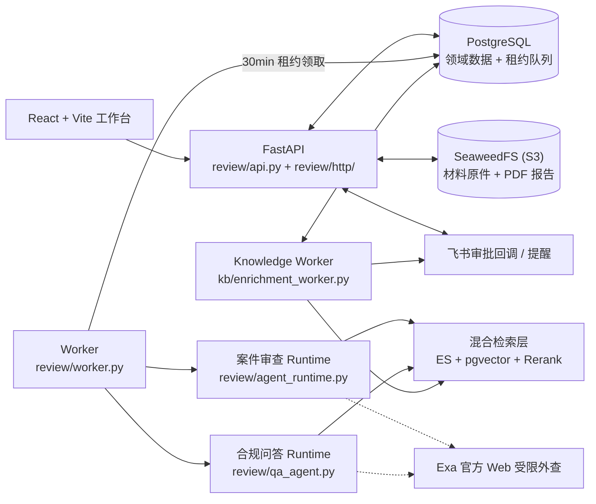
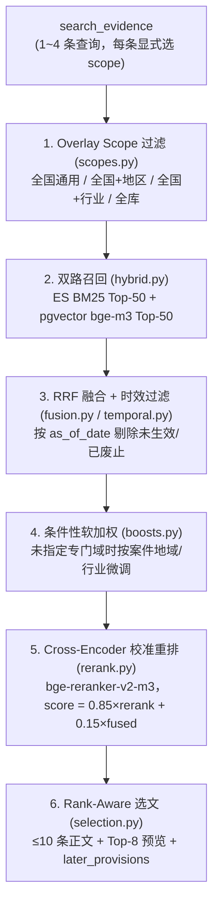
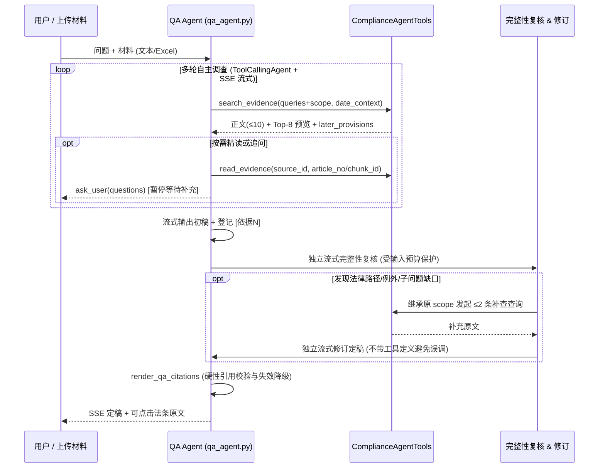

# CrossComply 全系统架构与核心实现技术深潜

> 本文档面向项目复习与深度理解，按 **运行时控制面 → 数据治理与知识库 → 多域混合检索 → 双 Agent 执行与门禁 → 企业治理闭环 → 三层防泄漏评测** 六大板块，完整梳理 CrossComply 整个项目的架构设计、模块边界、关键算法与代码落点。

---

## 一、总体架构、三进程拓扑与职责边界

CrossComply 的核心设计哲学是**严格的三权分立**：
- **Agent（决策与起草）**：决定读哪些材料、怎么拆查询、何时精读条文、何时暂停追问、何时交付草稿；
- **程序（确定性控制与持久化）**：冻结不可变快照、执行工具、强制预算上限、做引用门禁与状态持久化、执行所有对外动作；
- **人（事实确认、审批与治理）**：确认申报事实、核对报告、在飞书完成审批、验收整改、审核知识库发布。

### 1.1 运行时拓扑



### 1.2 三进程与状态机
- **API 进程（`law_agent/review/api.py` + `http/`）**：仅处理鉴权、领域写操作、流式推送与任务入队，绝不在 HTTP 请求内同步跑 Agent。
- **Worker 进程（`law_agent/review/worker.py`）**：统一领取 `ReviewTask`（案件审查）和 `QARun`（合规问答）。任务领取获 **30 分钟租约**，每次 Checkpoint 自动续约；进程崩溃或租约过期后自动重新入队并从最近 Checkpoint 恢复（Checkpoint 保存完整 `AgentState` 与可见步骤，不存模型私有思维链）。
- **Knowledge Worker（`law_agent/kb/enrichment_worker.py`）**：异步处理 Agent 提交的官方补库来源（抓取、解析、元数据推断、去噪与新旧法抽取），并投递飞书待办提醒。
- **案件状态机（`law_agent/review/workflow.py`）**：
  - `draft ⇄ needs_info → pending_review → review_running`
  - `review_running → needs_info | pending_source_verification | pending_feishu_approval | run_failed`
  - `pending_feishu_approval → approved | conditionally_approved | rejected`（终态仅由验签幂等飞书事件写回）
  - 凡证据不足、仍有缺失信息、或触发时效阻断（`freshness_hold`）的案件均禁止推进至审批。

---

## 二、受控数据治理与在线知识库（`law_agent/data/` & `law_agent/kb/`）

法律合规系统的上限取决于语料质量与元数据一致性。CrossComply 将**离线治理流水线**与**在线补库治理**统一到同一套 Schema 与引用策略上。

### 2.1 离线六阶段流水线（`law_agent/data/`）
```text
Source Manifest (人工审定清单)
  → fetch       (flk_npc.py / generic.py 下载原始文件)
  → normalize   (多格式解析器路由 → 统一 Document JSONL)
  → clean       (cleaners/common.py 确定性去噪 + 命中计数)
  → enrich      (enrichment/generator.py LLM 生成摘要/关键词/主题标签，不改写正文)
  → chunk       (chunking/pipeline.py 结构感知分块 → chunks.jsonl)
  → index       (ES 倒排 + PostgreSQL/pgvector bge-m3 双写同步)
```

- **多格式解析关键工程点（`normalize.py`）**：
  - `docx`：标准库 `zipfile + XML` 零重依赖解析，自动还原纵向合并单元格（`vMerge`，解决自贸区负面清单“数据类别”列跨行合并问题）。
  - `html`（`data/html_content.py`）：剥离 `nav`/`header`/`footer`/分享栏，处理政府网站 GBK 编码与响应式双份正文去重，并单独提取附件下载链接 `attachment_links`。
  - `pdf`（`data/pdf_layout.py`）：基于 `pdfplumber` 还原网格表格、合并跨页表、去掉逐页重复表头与页码、修复中文间多余空格；无文本层时才退回 Docling OCR（TableFormerV2 + RapidOCR）。
- **结构感知分块（`chunking/law.py` & `structured.py`）**：
  - **法律法规**：以“第 X 条”为最小单元，携带编/章/节 `heading_path`；超 650 字按“款”拆分，短于 120 字的款合并至相邻款。
  - **负面清单与表格密集文件**：一行一块，行首注入“分节路径 + 列名”（如 `二、车联网行业 | 需要安全评估清单 / 数据类别 | ...`），保证单行被独立召回时仍保留完整适用语境。
  - **政策问答**：按“一问一答”切块，问题即标题。

### 2.2 引用资格三层模型与元数据规则（`citation_policy.py` & `source_rules.py`）
1. **法律效力（`has_legal_effect`）**：仅 `library_kind="legal"` 且属于 `primary_legal_basis` 或 `conditional_*_basis` 下的 `law / regulation / judicial_interpretation` 具有法定条款效力；指南、标准、问答、示范合同与内部制度均无条款效力（可检索、可转述，严禁作为条款级依据）。
2. **条款定位（`has_clause_locator`）**：必须存在明确条号（如“第三十九条”）。`can_cite_clause = has_legal_effect ∧ has_clause_locator`。
3. **案件适用性**：地域、行业、时点不在此处硬过滤，而由检索域/软加权与在线语义校验约束。
4. **元数据一致性门禁（`source_rules.py`）**：入库、修改与发布前强制检查类型/效力层级/引用角色/发布机关/生效日期一致性（并由 `tests/test_source_rules.py` 对全语料做回归守卫）。

### 2.3 模型优先、规则兜底的在线入库与新旧法衔接（`kb/source_llm.py` & `retrieval/later_provisions.py`）
- **长文阈值**：`FULL_TEXT_THRESHOLD = 16_000` 字以内直读全文；超长按“头 6,000 + 尾 4,000”切片送入模型。
- **仅网页正文去噪（`trim_web_body`）**：对网页来源让模型返回原文逐字起止锚点 `body_start_quote` / `body_end_quote`，经精确子串校验后裁剪（杜绝改写幻觉，附件不做截断）。
- **新旧法衔接（`precedence_relations`）**：入库阶段由模型抽取新规对旧规/旧标准的取代或变更关系并做语料法源校验，规则正则（“与本规定不一致的”“废止”等）仅作 fallback。当 Agent 命中旧规时，系统自动附上审查时点已生效的 `later_provisions` 原文线索，引导 Agent 主动精读新规。

---

## 三、查询级多域混合检索与校准重排（`law_agent/review/retrieval/`）



- **动态语料驱动 `scope` 枚举（`scopes.py`）**：从当前语料动态构建合法检索域注入 `search_evidence` 工具 JSON Schema `enum`（默认 `全国通用`）。选择 `地区:上海`、`地区:粤港澳大湾区（香港）`、`行业:汽车` 等专门域时自动与 `全国通用` 构成 Overlay 池（广东/深圳自动覆盖大湾区）；全国通用池内非条款类文件上限 `NATIONAL_NON_CLAUSE_SLOTS = 3`，单份非条款文件最多占 2 席，保护正式法条可见度。
- **校准重排修复 RRF 归一化偏差（`rerank.py`）**：摒弃旧版单查询独立 min-max 拉伸（噪声查询 Top-1 会被错误抬至 1.0），改用固定上界缩放的 RRF 分与 Cross-Encoder 原始校准概率按 `w = 0.85` 线性混合，确保跨查询打分可直接横向比较。
- **正文与 Top-8 预览双层供给（`selection.py`）**：
  - 每条查询先按重排后席位拿前 2 席，剩余名额在各查询 Top-8 内按校准分分配，总正文上限 10 条；
  - ≤ 250 字的完整短条文直接全量返回（`acquired`）不占正文名额（覆盖 90%+ 法条）；
  - 未进入正文的 Top-8 位置按“最贴近查询的句子”截取 250 字预览（预览不可引用，需时精读）；同时挂载 `later_provisions` 新规线索。
- **强依赖约束**：ES 与 pgvector 必须同时可用，任一不可用显式失败，不做静默降级。

---

## 四、双 Agent 运行时与硬性校验门禁

### 4.1 案件审查 Agent（`review/agent.py` + `agent_runtime.py` + `agent_tools.py`）
- **决策循环与预算**：每轮输出单个 `AgentDecision` JSON，由程序执行，无固定流水线顺序。默认预算：**16 轮、5 次检索、10 次精读、5 次 Web 搜索、2 条补库**；预算耗尽仅允许以 `insufficient_evidence` 收口。
- **10 类受控动作**：`propose_plan`、`read_material(s)`（单次 ≤ 48KB，支持 Excel 按工作表读取）、`grep_materials`、`run_python`（WASI 沙箱隔离计算）、`search_evidence`、`read_evidence`（按条号/chunk/目录精读）、`search_web`（仅官方域，只作调查上下文）、`queue_enrichment`、`request_input`（持久化暂停，附结构化 `fact_questions`）、`finish`（提交报告草稿进门禁）。
- **事实账本与事务化事实确认（`fact_provenance.py` & `fact_confirmation.py`）**：
  - `AgentState.fact_ledger` 记录每条事实的 `field / value / source_type / source_ref / status`；Agent 无法通过工具篡改可信等级。
  - `request_input` 回答记为 `applicant_statement / unverified`；申请人点击确认时，服务端在**单事务**内完成：写回 intake → 生成新 `IntakeSnapshot` → 关闭旧等待任务 → 入队新 `ReviewTask`，任一步失败整体回滚。
- **双层硬校验门禁（不通过则保留 `report_draft` 带反馈退回 Agent 修订）**：
  1. **确定性引用门禁（`ComplianceAgentTools.finalize`）**：法律主张必须由 `can_cite_clause=true` 且在审查时点已生效的已获取 chunk 支撑；材料引用必须精确唯一命中当前快照原文；非证据不足结论至少有 1 条可引用法条；若外查发现改变核心结论的新官方材料（`web_impact=core`），置 `freshness_hold=true` 阻断送审。
  2. **独立语义校验器（`semantic_grounding.py::SemanticGroundingVerifier`）**：由独立模型（`LAWAGENT_SEMANTIC_MODEL`）对照冻结事实、材料原文、事实账本与被引法条，逐项核验每条主张、结论、路径、风险边界与地域/行业适用性；地域/行业不符判 `unsupported`，事实不足判 `uncertain`，任一分项不通过均不可被总体通过掩盖。

### 4.2 合规问答 Agent 与完整性复核（`review/qa_agent.py` + `qa_citations.py`）



- **统一流式与容错（`law_agent/llm/openai_compatible.py` & `usage.py`）**：`chat_json` 与 `_chat_strict_tool` 统一默认 SSE 流式 + `json_repair` 兜底，实时采集 `first_token_ms`、`prompt_tokens`、`completion_tokens`、`cache_hit_tokens`。
- **完整性复核设计要点**：复核阶段按字符预算打包材料与证据（被引/补查条文保留全文，未引条目压缩摘要）；补查通过 `_completeness_search_scope(state)` 自动继承本轮专业 `scope`；若复核/补查/修订任一环节异常，安全降级交付初稿并记录失败阶段。
- **案件问答（`matter_agent.py`）**：绑定特定案件快照与已审报告，经过引用门禁 + 语义校验，超 120,000 字符上下文显式拒绝，绝不直接改写原报告或原事实。

---

## 五、企业治理闭环（`portfolio` / `impact` / `feishu` / `reports` / `eval_feedback`）

| 模块 | 文件位置 | 核心实现机制 |
| --- | --- | --- |
| **同主体累计台账** | `review/portfolio.py`、`transfer_store.py` | 按主体和自然年汇总持续业务的已签署审批基线，展示单项最大值与未去重合计；入队冻结时排除本案自身，绝不把过期或无法解析记录当零处理 |
| **法规变更影响监测** | `kb/change_detection.py`、`review/impact.py` | 审查完成后索引实际引用条款；知识库发布新版本前后自动比对条文与日期变更，匹配当前审批基线与待审报告；阻断级标记直接拦截飞书送审，由法务决策忽略或发起复审 |
| **飞书审批与提醒** | `review/feishu.py`、`work_reminders.py` | 审批回调严格验签 + 幂等落库，是审批终态唯一写入口；`knowledge-worker` 定时推送待办提醒 |
| **PDF 决策报告与整改** | `review/reports.py`、`remediation.py` | 渲染含法条原文、事实依据与 SHA-256 校验和的 PDF 报告存入 SeaweedFS；同步生成可分配/验收的整改清单 |
| **线上纠错回流** | `review/eval_feedback.py`、`eval_draft_store.py` | 从人工审阅/审批提取纠错候选，经法务脱敏与规则校验后由 `evals/field.py` 导出至 Git 外的 `field` 评测集 |

---

## 六、三层防泄漏评测体系与关键设计权衡（`law_agent/evals/`）

### 6.1 三层解耦评测设计
- **场景库纪律**：78 个企业合规场景（`dev` 42 题调优、`test` 36 题 `lock-test` 散列锁定），每题固定 `as_of_date`，双层标注 `retrieval`（含 `equivalents` 等价条款组与 `must_not_cite` 排除条文）与 `agent_rubric`，并对语料中有官方问答直接给答案的场景打 `answer_leak_sources` 标记以单列 `no-leak` 子集。
- **L1 离线单轮查询回放（`query_replay.py`）**：冻结 `dev` 问答中 Agent 实际写出的 197 条查询，直通生产检索 + 重排（零 LLM 方差），用于受控 A/B 消融。
- **L2 多轮问答证据召回（`qa_eval.py` + `evidence.py`）**：运行生产 `execute_qa`，按 `(source_id, article_no)` 及等价组统计证据召回与回答引用，并通过 `read_records` 追踪每次精读来源（预览 / 新规关联 / 同源其他条 / 续读目录 / 自行指定）。
- **L3 端到端跨模型双盲评测（`grading.py` + `agent_eval.py` + `report.py`）**：确定性规则检查 + 独立裁判（`claude-opus-5.5`）匿名打乱评判 `crosscomply_qa` vs 同底座 `direct`，输出总通过率、4 维无瑕率、危险错误率 `wrong_definite` 与 95% Wilson 置信区间。

### 6.2 关键实测与消融证伪速查（复习自测）

| 问题 | 结论与实测依据 |
| --- | --- |
| **为什么 `w = 0.85` 校准重排优于纯重排 `w = 1.00`？** | 197 查询离线回放上，`w=0.85` 使 `mc@8` 从 `72.6% → 84.5%（+11.9 pp）`、`body_mr = 94.1%`；纯重排 `w=1.00` 反使 `body_mr` 掉至 `88.2%` |
| **为什么 `RESULT_DEPTH` 选 8 而不是 6 或 10？** | `depth=6` 时 `mc@6` 跌至 `76.2%`；`depth=10` 增益 `0.0%` 但单批上下文均值从 `18.2` 膨胀至 `20.3`，`8` 为精确拐点 |
| **哪些直觉优化被离线回放证伪并放弃？** | ① ES 中文↔阿拉伯数字条号扩展：**+0.0%**（`bge-m3` 已召回，旧问题源于 RRF 归一化偏差）；② 未提及法源条款上限截断（cap 2/3/4）：`mc@8` 反降 **-1.2 pp**（`84.5% → 83.3%`） |
| **锁定 `test` 36 题最终效果如何？** | 多轮必引证据召回 **90.5%**（`no-leak` **88.9%**）、回答引用 **85.1%**、引用门禁 **97.2%**；`claude-opus-5.5` 双盲评判总通过率 **97.2% vs 86.1%**，法律准确性完全无瑕率 **77.8% vs 13.9%（+63.9 pp）**，条号错引率 **19.4% vs 72.2%**，危险错误率 **0% vs 2.8%** |
| **官方默认 `deepseek-flash` 的延迟与成本？** | 单查询检索 **P50 1.37s / P95 1.51s**，批量检索（2.3 条）**P50 2.44s / P95 3.40s**；端到端多轮问答 **P50 54.1s**（均值 7.5 次 LLM 调用），无缓存成本上限均值 **¥0.29 / 次**（叠加 Prefix Cache 约 **¥0.10–0.18 / 次**） |
