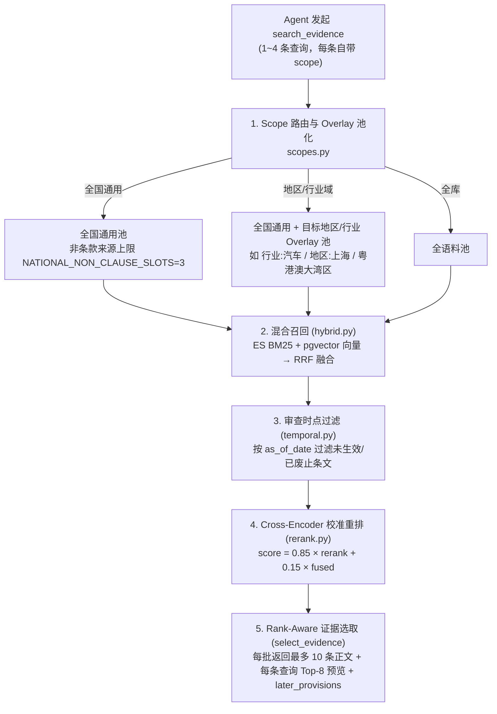
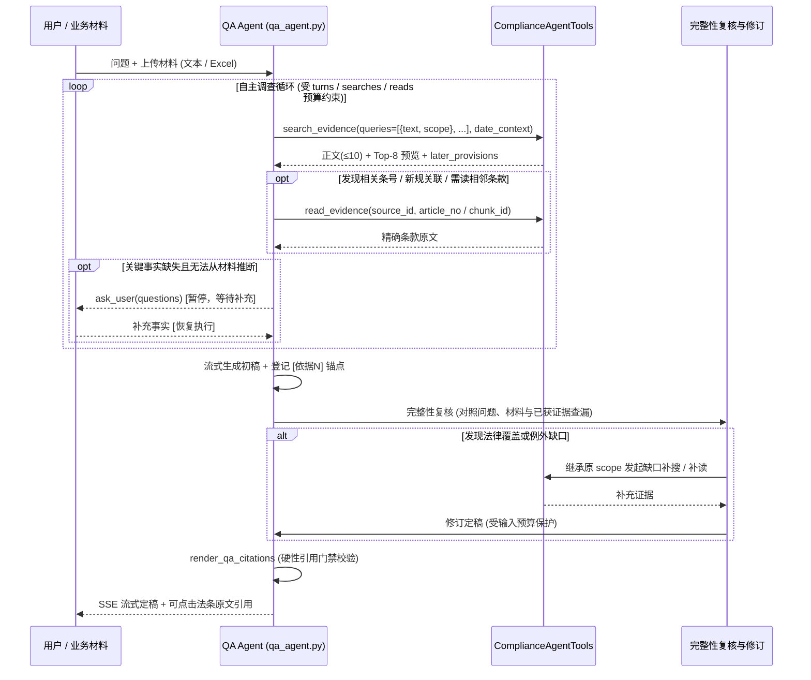

# CrossComply 检索、问答与评测全链路技术深潜

> 本文档面向项目维护者与复习回顾，按数据流与执行流完整梳理 **受控入库 → 多域混合检索与校准重排 → 多轮自主问答与完整性复核 → 硬性引用门禁 → 三层防泄漏评测** 的架构设计与代码级实现。

---

## 1. 受控语料入库与新旧法衔接

法律合规 RAG 的第一道防线不在检索，而在**入库质量**。如果网页导航栏污染了正文、或者新旧法替代关系缺失，后续检索和 LLM 再强也会出错。

### 1.1 模型优先、规则兜底（`law_agent/kb/source_llm.py`）
- **长文处理阈值**：定义 `FULL_TEXT_THRESHOLD = 16_000` 字符。正文 ≤ 16,000 字时直接将全文交给模型抽取元数据、正文边界与新旧法关系；超长文本才按“头 6,000 + 尾 4,000”切片送入模型，避免信息丢失。
- **仅网页去噪（`trim_web_body`）**：
  - 政府官网页面常夹杂顶部导航、面包屑、底部“相关阅读”等噪声（典型案例：2025 年第 53 号公告曾因正文混入底部导航，导致分块被截断污染）。
  - 对网页抓取内容，模型返回原文逐字起止锚点 `body_start_quote` / `body_end_quote`，程序做**原文子串精确校验**后裁剪；若锚点未命中则安全回退原文，**绝不让模型重写或摘要法条**。
  - 附件文档（PDF / DOCX）结构本身干净，不走网页裁剪逻辑。
- **新旧法衔接关系抽取（`precedence_relations`）**：
  - 入库阶段由模型识别“本文件取代/修订/变更了哪部旧文件或旧标准的适用依据”，经语料法源校验后持久化；规则匹配（`law_agent/review/retrieval/later_provisions.py`）仅作为无模型关系时的 fallback。
  - 检索命中旧规（如 2022 年《个人信息保护认证实施规则》）时，系统会自动在返回结果上挂载 `later_provisions`（指向 2025 年第 53 号公告 / GB/T 46068），引导 Agent 主动精读现行新规。

### 1.2 引用资格门禁与双写存储
- **引用资格（`law_agent/data/citation_policy.py`）**：
  - 区分“可作为法定条款引用”（`primary_legal_basis` + 存在条号定位 `has_clause_locator`）与“仅作辅助解读/实施参考”（指南、政策问答、答记者问）。
  - 检索返回的每条 `RetrievalHit` 都带有 `can_cite_clause: bool`，从源头防止把政策问答包装成法律条款。
- **ES + PostgreSQL/pgvector 双写同步**：
  - 当前受控库共 **65 份官方来源、2,119 个结构化分块（46.9 万字）**，同时写入 Elasticsearch（倒排 BM25 + 结构化过滤字段）与 PostgreSQL/pgvector（`bge-m3` 向量索引）。

---

## 2. 查询级多域混合检索与校准重排

### 2.1 为什么设计查询级 Overlay `scope` 池？（`law_agent/review/retrieval/scopes.py`）
- **痛点**：企业合规场景常同时涉及“全国上位法（个保法、2024 跨境流动规定）”与“地方自贸区负面清单 / 行业特别规定（上海、北京、大湾区、汽车）”。全库混搜容易让地方/行业碎片淹没全国核心条款；硬切单域又会漏掉全国上位法。
- **解法**：
  - 从当前语料动态生成合法 `scope` 枚举（`scope_catalog`）注入 Agent 工具 Schema，要求每条查询显式选择检索域（杜绝 `(未指定)`）。
  - 选择某个地方/行业域（如 `地区:粤港澳大湾区（香港）` 或 `行业:汽车`）时，检索池自动叠加“全国通用 + 该专门域”作为 Overlay；广东/深圳场景自动纳管大湾区相关规范。
  - 全国通用域设置 `NATIONAL_NON_CLAUSE_SLOTS = 3`，限制指南/问答等非条款来源在一批结果中的占位上限，防止挤掉必引法条正文。

### 2.2 校准重排与 Rank-Aware 选文（`rerank.py` / `hybrid.py`）
- **修复旧版 RRF min-max 偏差**：旧版对单条查询内的 RRF 分数做 min-max 归一化，导致“本身命中质量很差的噪声查询”的 Top-1 也被抬到 1.0，挤占了优质查询的第 2、3 名。
- **校准混合公式**：`final_score = 0.85 × cross_encoder_score + 0.15 × fused_score`（`DEFAULT_RERANK_BLEND_WEIGHT = 0.85`）。离线 197 查询消融证实 `w=0.85` 优于纯重排 `w=1.00`（`body_mr` 从 `88.2%` 提升至 `94.1%`）。
- **正文 + 预览双层返回（`RESULT_DEPTH = 8`）**：
  - 一批查询最多返回 10 条完整法条正文（在 spread 去重之后按排序名次择优选取），控制上下文预算；
  - 每条查询 Top-8 中未进入正文的条款，以“来源 + 条号 + 预览摘要”形式列出，并在已返回来源上附带 `later_provisions` 新规线索，让 Agent 按需发起 `read_evidence` 精准补读。
  - 消融验证：`depth=6` 会导致 `mc@6` 跌至 `76.2%`；`depth=10` 增益为 `0.0%` 却使单批平均上下文从 `18.2` 膨胀至 `20.3`，`depth=8` 为精确拐点。

---

## 3. 多轮自主问答与完整性复核闭环

### 3.1 核心工程机制（`law_agent/review/qa_agent.py` & `law_agent/llm/`）
- **统一 SSE 流式调用 + `json_repair` 兜底**：`OpenAICompatibleClient` 的 `chat_json` 与 `_chat_strict_tool` 默认启用流式传输，既降低长输出超时风险，也实时记录 `first_token_ms`、`prompt_tokens`、`completion_tokens` 与 `cache_hit_tokens`（`law_agent/llm/usage.py`）；遇到偶发 JSON 截断或轻微语法瑕疵时自动走 `json_repair` 兜底。
- **完整性复核（Completeness Review）**：
  - 不是独立系统，而是多轮问答的内置收口环节：先审查初稿是否遗漏核心法律路径、前置义务或豁免例外；若发现缺口，自动通过 `_completeness_search_scope(state)` **继承原调查的专业检索域**（避免补搜时掉回全国通用域而漏掉地方/行业新规），补读后再修订定稿。
  - 对复核与修订阶段的上下文实施显式字符预算打包，防止长对话触发模型上下文溢出。
- **硬性引用门禁（`qa_citations.py`）**：
  - 最终交付前，`render_qa_citations` 校验回答中每个 `[依据N]` 均对应本次调查已实际获取的 `chunk_id` 或官方网页证据；未通过校验的引用不会原样透出，必要时触发 `citation_repair_tool` 修复或降级。
  - 若回答时点 `answer_as_of_date` 下某条文已失效，自动降级 `can_cite_clause = False`，防止引用失效条款。

---

## 4. 三层防泄漏评测体系

评测代码位于 `law_agent/evals/`，与生产代码完全解耦。核心原则：**检索召回不能代替回答正确率；`dev` 调参不能混入 `test` 汇报**。

### 4.1 场景库与防泄漏纪律（`law_agent/evals/bank/`）
- 共 78 个结构化企业场景：`dev`（42 题，用于迭代调优）与 `test`（36 题，经 `lock-test` 散列锁定，禁止调参）。
- 每个场景包含：
  - 固定审查时点 `as_of_date`（消除“今天日期”漂移）；
  - 真实可解析的业务材料包（文本 + 多工作表 Excel）；
  - 双层标签：`retrieval`（`must_cite` 必引条款 + 等价条款组 `equivalents`、`must_retrieve` 必检来源、`must_not_cite` 排除/失效条文）与 `agent_rubric`（允许/禁止判断边界、`must_not_assume`、`clarification_expectations`、`must_cover_sources`）；
  - `answer_leak_sources` 标记：凡语料中官方政策问答已直接给出原题答案的场景，报告中必须单独拆分出 `no-leak` 子集。

### 4.2 三层评测职责与实现

| 层级 | 模块 | 输入与运行方式 | 核心指标 | 解决什么问题 |
| --- | --- | --- | --- | --- |
| **L1 离线单轮回放** | `query_replay.py` | 冻结 `dev` 问答中 Agent 写出的 197 条真实查询，直接送入生产检索 + 重排（不调 LLM） | `mc@3/8/12/50`、`mr@8`、`body_mc`、`body_mr` | 低成本、零方差地做检索/重排 A/B 消融，证伪负收益优化 |
| **L2 多轮问答召回** | `qa_eval.py` + `evidence.py` | 跑完整生产 `execute_qa`，按 `(source_id, article_no)` 及等价组统计证据召回、回答引用与 `read_records` 精读溯源 | 必引条款证据召回、回答引用率、必检来源召回、排除条款场景数 | 衡量多轮自主检索 + 精读 + 完整性复核最终找齐和用上了多少关键法条 |
| **L3 端到端双盲评测** | `grading.py` + `agent_eval.py` + `report.py` | 对比 `crosscomply_qa` 与同底座裸模型 `direct`；先过确定性规则检查，再由独立第三方模型（Claude Opus 5.5）匿名打乱盲评 | 总通过率、`wrong_definite` 危险错误率、4 维无瑕率、95% Wilson 区间 | 衡量最终法律结论是否真正正确、是否消除了时效幻觉与条号错引 |

---

## 5. 关键设计权衡与复习自测（FAQ）

1. **为什么不做 ES 中文↔阿拉伯数字条号扩展（如“第八条”↔“第8条”）？**  
   197 条真实查询离线 A/B 证明增益为 **0.0%**——`bge-m3` 语义向量本身已经能稳定召回，旧版条号排位靠后本质是 RRF min-max 归一化偏差，改用校准重排（`w=0.85`）后已根治。
2. **为什么不限制未提及法源的条款占位上限？**  
   离线消融测过 cap = 2/3/4，`mc@8` 反而从 `84.5%` 跌至 `83.3%`（因为很多问题不直接点名法源，却需要同一部核心法规的 3~4 个关联条文同时进入正文），因此果断否决。
3. **为什么 `RESULT_DEPTH` 定在 8 而不是 6 或 10？**  
   `depth=6` 召回明显掉点（`76.2%`），`depth=10` 零增益但上下文膨胀 11.5%（`18.2 → 20.3`），`8` 是实测拐点。
4. **为什么网页去噪和新旧法关系采用“模型优先、规则兜底”？**  
   官网 HTML 结构千变万化，纯正则极易漏切或误切；让模型输出原文逐字起止锚点并做精确子串校验，既泛化强又保证**零改写幻觉**，失败时安全回退规则。
5. **跨模型双盲评测为什么最有说服力？**  
   同一底座模型（DeepSeek）作答、更强的第三方模型（Claude Opus 5.5）在剥离系统标识与内部字段后匿名打乱盲评，彻底消除同模型自评偏见；且同时拆出 `legal_correctness = pass`（**77.8% vs 13.9%**），直接量化检索与引用门禁对“消灭条号错引与过时法条幻觉”的净价值。
6. **生产环境下检索和问答的性能与成本如何？**  
   官方默认 `deepseek-flash` + 本地 ES/pgvector 实测：单查询检索 **P50 1.37s / P95 1.51s**；端到端多轮问答（含完整性复核）**P50 54.1s**，平均 7.5 次 LLM 调用、单次成本约 **¥0.10–0.29**（详见 [EVALUATION_REPORT.md](../EVALUATION_REPORT.md)）。
